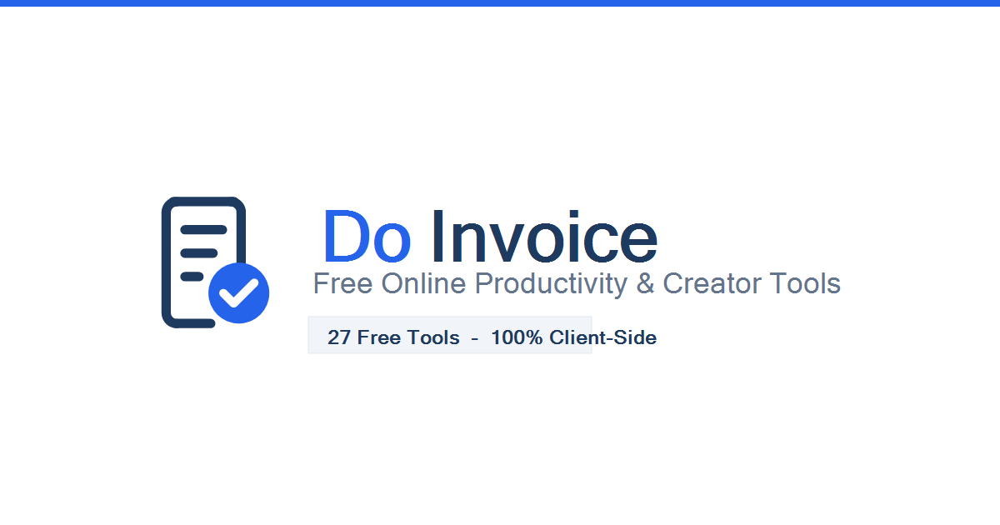

  

  # DoInvoice Generator

  **Free Online Invoice Generator & Privacy-First Productivity Tools**

  
  
  

  

    <a href="https://doinvoicegenerator.online/"><strong>Launch Application »</strong></a>
     
     
    <a href="https://doinvoicegenerator.online/tools">Explore All Tools</a>
    ·
    <a href="https://doinvoicegenerator.online/blog">Practical Guides & Tutorials</a>
    ·
    <a href="https://doinvoicegenerator.online/about">About Us</a>
  

---

## Overview

[**DoInvoice Generator**](https://doinvoicegenerator.online/) is a modern web platform engineered for freelancers, small business owners, contractors, and independent professionals. It delivers instant, browser-based invoicing and a suite of 27 productivity utilities without paywalls, account registration, or intrusive data collection.

Every tool operates directly inside the browser using client-side execution. Invoices, financial amounts, client details, and documents remain private on the user's local device.

---

## Preview

  
  
<em>Interactive preview of the DoInvoice Generator platform and utilities catalog.</em>

---

## Tool Catalog

DoInvoice Generator provides 27 purpose-built utilities organized into six categories:

### 💼 Business & Invoicing
- [**Invoice Generator**](https://doinvoicegenerator.online/tools/invoice-generator) — Create customized, professional invoices with itemized line items, tax, discounts, live preview, and instant print/PDF export.
- [**Receipt Generator**](https://doinvoicegenerator.online/tools/receipt-generator) — Generate clean payment receipts with transaction IDs, payment methods, and PDF download.
- [**Quote / Estimate Generator**](https://doinvoicegenerator.online/tools/quote-generator) — Draft project estimates and client price proposals with customizable terms.
- [**Invoice Number Generator**](https://doinvoicegenerator.online/tools/invoice-number-generator) — Create sequential, prefixed reference numbers for invoices, purchase orders, and bill tracking.
- [**Email Signature Generator**](https://doinvoicegenerator.online/tools/email-signature-generator) — Design branded HTML email signatures with contact details, social links, and live copy-paste preview.

### 📄 Career & Professional
- [**Resume / CV Builder**](https://doinvoicegenerator.online/tools/resume-builder) — Build clean, ATS-compliant resumes with customizable layout sections and instant PDF rendering.
- [**Cover Letter Generator**](https://doinvoicegenerator.online/tools/cover-letter-generator) — Draft tailored, structured cover letters ready for submission.
- [**Resume Keyword Checker**](https://doinvoicegenerator.online/tools/resume-keyword-checker) — Compare resume content against target job descriptions to identify missing keywords.
- [**Salary Calculator**](https://doinvoicegenerator.online/tools/salary-calculator) — Convert compensation across hourly, weekly, monthly, and annual pay schedules.

### ✍️ Text & Content Utilities
- [**Word Counter**](https://doinvoicegenerator.online/tools/word-counter) — Real-time metrics for word count, characters (with/without spaces), sentences, reading time, and keyword density.
- [**Text Case Converter**](https://doinvoicegenerator.online/tools/text-case-converter) — Convert text between UPPERCASE, lowercase, Title Case, camelCase, snake_case, and sentence case.
- [**Remove Duplicate Lines**](https://doinvoicegenerator.online/tools/remove-duplicate-lines) — Clean up messy lists by stripping duplicate rows and sorting unique entries.
- [**Text Cleaner**](https://doinvoicegenerator.online/tools/text-cleaner) — Normalize whitespace, strip HTML tags, and remove unnecessary line breaks.
- [**Text Sorter**](https://doinvoicegenerator.online/tools/text-sorter) — Alphabetize lists, sort by line length, reverse entries, or randomize order.
- [**Text Diff Checker**](https://doinvoicegenerator.online/tools/text-diff-checker) — Side-by-side comparison of text versions with visual difference highlighting.
- [**Markdown to HTML Converter**](https://doinvoicegenerator.online/tools/markdown-to-html) — Convert Markdown syntax to clean, semantic HTML markup.
- [**Word Frequency Counter**](https://doinvoicegenerator.online/tools/word-frequency-counter) — Analyze word occurrence distribution and percentage share.
- [**Lorem Ipsum Generator**](https://doinvoicegenerator.online/tools/lorem-ipsum-generator) — Generate placeholder text customized by paragraphs, sentences, or word counts.
- [**Slug Generator**](https://doinvoicegenerator.online/tools/slug-generator) — Transform headings and titles into clean, URL-safe SEO slugs.

### 🎬 Media & Recording
- [**Screen Recorder**](https://doinvoicegenerator.online/tools/screen-recorder) — Record browser tabs, application windows, or full desktop screens with audio directly in browser.
- [**Video to GIF Converter**](https://doinvoicegenerator.online/tools/video-to-gif) — Convert short video clips into animated GIFs with customizable dimensions and frame rates.
- [**GIF Maker**](https://doinvoicegenerator.online/tools/gif-maker) — Combine multiple still images into animated GIFs.

### 🎙️ Voice & Speech
- [**Text to Speech**](https://doinvoicegenerator.online/tools/text-to-speech) — Synthesize typed text into spoken audio using browser speech synthesis voices.
- [**Speech to Text**](https://doinvoicegenerator.online/tools/speech-to-text) — Transcribe microphone audio input into real-time written text.

### 🛠️ Daily Utilities
- [**Time Zone Converter**](https://doinvoicegenerator.online/tools/timezone-converter) — Compare times and schedule across international time zones with daylight saving adjustments.
- [**Random Name Generator**](https://doinvoicegenerator.online/tools/random-name-generator) — Generate realistic persona names for testing, databases, and creative writing.
- [**Username Generator**](https://doinvoicegenerator.online/tools/username-generator) — Create distinctive username ideas for platforms, games, and accounts.

---

## Key Features

- **100% Client-Side Architecture:** Calculations, document generation, and conversions execute inside the browser sandbox.
- **Zero Account Friction:** No mandatory signups, logins, credit cards, or trial expirations.
- **Watermark-Free Export:** Generated PDF documents, invoices, and resumes are completely unbranded.
- **Fast Performance:** Static-first architecture powered by Next.js App Router for sub-second page transitions.
- **Mobile Responsive:** Interfaces optimized for smartphones, tablets, laptops, and ultra-wide screens.

---

## Technology Stack

The live platform is built with modern, production-grade web technologies:

- **Framework:** [Next.js](https://nextjs.org/) (App Router, Static Site Generation)
- **UI Library:** [React](https://react.dev/) & [TypeScript](https://www.typescriptlang.org/)
- **Styling:** [Tailwind CSS](https://tailwindcss.com/)
- **Iconography:** [Lucide React](https://lucide.dev/)
- **Browser APIs:** HTML5 Canvas, Web Audio, SpeechRecognition, SpeechSynthesis, MediaStream Recording

---

## Privacy & Security

User data confidentiality is the core design principle of DoInvoice Generator:

- **No Remote Database Storage:** Form inputs, invoice amounts, client addresses, and notes are not transmitted to or stored on remote servers.
- **Ephemeral Sessions:** Text processing, diff comparisons, and file conversions occur in memory within the local browser tab.
- **No Tracking of Document Data:** Detailed privacy policies and architecture standards are documented publicly on the [Privacy Policy](https://doinvoicegenerator.online/privacy-policy) page.

---

## Links & Resources

- **Official Website:** [https://doinvoicegenerator.online/](https://doinvoicegenerator.online/)
- **Tools Directory:** [https://doinvoicegenerator.online/tools](https://doinvoicegenerator.online/tools)
- **Blog & Guides:** [https://doinvoicegenerator.online/blog](https://doinvoicegenerator.online/blog)
- **About the Project:** [https://doinvoicegenerator.online/about](https://doinvoicegenerator.online/about)
- **Contact & Feedback:** [https://doinvoicegenerator.online/contact](https://doinvoicegenerator.online/contact)

---

## Repository Notice

This public repository serves as the official project showcase and documentation index for [DoInvoice Generator](https://doinvoicegenerator.online/). The full production web application is hosted and deployed independently.

© 2026 DoInvoice Generator. All rights reserved.
